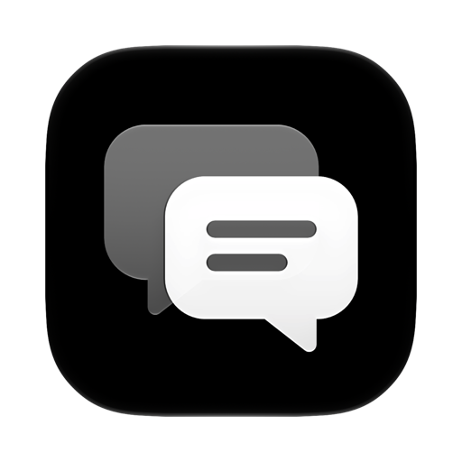

<p align="center">
  
</p>

<h1 align="center">GlassChat</h1>

<p align="center"><strong>Your favorite AI models. Right at home on Mac.</strong></p>

GlassChat is a native AI chat app built with SwiftUI and Liquid Glass. Its design starts with a simple question: what would an AI conversation app look and feel like if it belonged in macOS from the beginning?

Translucent surfaces, familiar controls, and a focused conversation window put the experience first. Bring your own API key, choose a model, and make yourself at home.

**Requires macOS 26 or later.**

## Designed for Mac

GlassChat follows the visual language of macOS: a sidebar for your conversations, a model picker right in the chat window, and a composer that turns into a drop zone when you drag files over it. Light and dark appearances include matching app icons.

Built with native SwiftUI controls and Liquid Glass, the interface is designed to feel like part of your Mac.

## Your models, your connection

Connect to an OpenAI-compatible API, including OpenAI, OpenRouter, or a local server such as Ollama or LM Studio. Set your base URL, API key, and default model in one place, then switch models from the conversation window.

- **Streaming responses** with Markdown, highlighted code, and LaTeX math.
- **File attachments** through the paperclip, paste, or drag and drop: images, audio, PDFs, text, and code.
- **System prompts** for the whole app or an individual conversation.
- **Local chat history** saved on your Mac, with API keys stored in macOS Keychain.
- **MCP tools** for connecting the conversation to local processes and remote services.

Available models and support for attachments, audio, and tool calling depend on your provider and chosen model. GlassChat connects to your configured services; it does not include API credits.

## Get started

Build and install the app using the instructions below. On first launch:

1. Enter your provider's API base URL. The default is `https://api.openai.com/v1`.
2. Enter your API key and choose a model.
3. Start a conversation.

Open **Settings (⌘,)** to change your connection, default model, or global system prompt. Use the chat toolbar to set a prompt for an individual conversation.

## Tools and MCP

GlassChat supports local MCP servers over stdio and remote servers over Streamable HTTP. Open **Settings → MCP** and use the familiar `mcpServers` JSON format:

```json
{
  "mcpServers": {
    "local-tools": {
      "command": "/absolute/path/to/mcp-server",
      "args": [],
      "env": {}
    },
    "remote-tools": {
      "url": "https://your-server.example/mcp",
      "headers": {
        "Authorization": "Bearer YOUR_TOKEN"
      },
      "disabled": true
    }
  }
}
```

Replace the example values with your server's configuration. Local commands run through a login shell, so tools such as `npx` and `uvx` can use your shell's PATH when installed.

The hammer button in the composer controls built-in app tools and each MCP server. These choices apply across conversations. Tool calls appear as cards in the chat and execute automatically without a per-call confirmation; configure servers and credentials accordingly.

Built-in tools let the model manage chats, switch models, show notifications and alerts, and manage the MCP configuration. Chat and model switches take effect after the current response finishes.

### Tool discovery

The model can search for tools by what they do, including tools whose groups are switched off. Discovered tools become available for the rest of the current response, so switching a group off does not prevent its tools from being discovered and used.

By default, discovery uses word matching and returns up to four tools. An optional decision model can rank results instead; configure it under **Settings → Connection → Tool Search**. This ranking uses the `/alpha/decisions` endpoint and requires a compatible service.

## Data and storage

Conversations and imported attachments are saved locally:

| Data | Location |
| --- | --- |
| Chat history | `~/Library/Application Support/GlassChat/chats.json` |
| Attachment copies | `~/Library/Application Support/GlassChat/files/` |
| MCP configuration | `~/Library/Application Support/GlassChat/mcp.json` |
| Connection API keys | macOS Keychain |

Messages and attachments are sent to the API endpoint you configure when used in a conversation. Connected MCP servers receive the arguments supplied to their tools. If you enable a decision model, tool search queries and candidate tool descriptions are sent to its configured endpoint. Local storage does not mean that conversations with remote providers stay on your device.

MCP configuration is stored as JSON, including any credentials you place in its `env` or `headers` fields.

## Build and install

The current build scripts use Swift 6.2 or later and the **macOS 26.5 SDK**, installed at:

```text
/Library/Developer/CommandLineTools/SDKs/MacOSX26.5.sdk
```

With the matching Command Line Tools installed, run from the repository root:

```bash
scripts/bundle.sh --open
```

The script builds in release mode, assembles and signs `build/GlassChat.app` with an ad hoc signature, installs it into `~/Applications`, and opens it. It closes any running GlassChat process and replaces the existing app at that location.

To build the executable without installing the app:

```bash
swift build -c release --sdk /Library/Developer/CommandLineTools/SDKs/MacOSX26.5.sdk
```

These scripts produce a local build. App Store distribution or notarized distribution requires separate signing and packaging.

### App icon

The icon source is `Resources/AppIcon.icon`. Edit it in Icon Composer, then regenerate the bundled assets before rebuilding:

```bash
scripts/make-icon.sh
scripts/bundle.sh --open
```

The icon script expects Icon Composer at `/Applications/Icon Composer.app` and exports `AppIcon.icns`, `AppIcon-Light.png`, and `AppIcon-Dark.png` into `Resources`.

## Development notes

- The build targets the macOS 26.5 SDK to avoid SwiftUI macro plugin requirements encountered with the macOS 27 SDK in the Command Line Tools setup.
- Conversations are persisted as JSON through `ChatStore`.
- `Vendor/HighlightSwift` contains HighlightSwift 1.1.0 with `@Entry` and `#Preview` removed for this build setup.
- `Vendor/swift-markdown-ui` contains MarkdownUI 2.4.1 with patches for inline image baselines and handling failed inline images.
- LaTeX is rendered with bundled KaTeX 0.16.11 in a hidden web view. Formula rendering works offline and supports `$...$`, `$$...$$`, `\(...\)`, and `\[...\]`.
